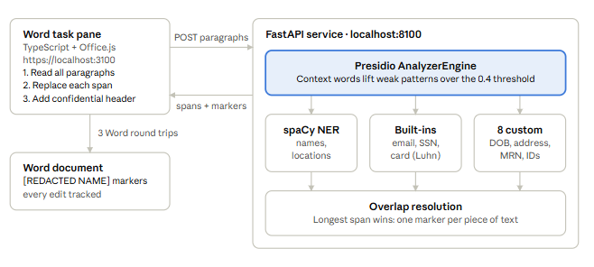

#  DocInfoShield

**One-click redaction of sensitive information in Microsoft Word.**

DocInfoShield is a Word add-in that finds personal and confidential data in a document (names, emails,
phone numbers, SSNs, credit cards, addresses, dates of birth, medical and employee IDs) and replaces each one
with a clear marker such as `[REDACTED NAME]`. Every edit is recorded as a tracked change, and a
**CONFIDENTIAL DOCUMENT** header is added, so the redaction can be audited.

Detection runs in a local **Python FastAPI** service powered by
**[Microsoft Presidio](https://microsoft.github.io/presidio/)** and **spaCy**. 
- A small **TypeScript** task
pane applies the results inside Word. Document text never leaves `localhost`.

## Demo

[](https://youtu.be/raSQUB77CD4)

▶️ **[Watch the 7-minute demo on YouTube](https://youtu.be/raSQUB77CD4)**: architecture, a live redaction of
the sample document, and how context-aware scoring works.

## Architecture



| Component | Technology | Responsibility |
|---|---|---|
| Word task pane | TypeScript, Office.js, served at `https://localhost:3100` | Reads paragraphs, applies replacements as tracked changes, adds the header |
| Detection API | FastAPI + uvicorn at `https://localhost:8100` | `POST /api/detect` returns, for each paragraph, the spans to redact and their markers |
| Presidio AnalyzerEngine | `presidio-analyzer` | Runs all recognizers and scores each hit; context words boost weak matches |
| spaCy NER | `en_core_web_lg` | Names and locations, which have no fixed format |
| Built-in recognizers | Presidio | Email, SSN, credit card (Luhn-validated), bank numbers, passports, IPs … |
| 8 custom recognizers | `backend/app/detector.py` | DOB, street address, MRN / insurance ID, order number, employee ID, US phone, card-like numbers, partial IDs |
| Overlap resolution | `_resolve_overlaps` | Keeps one result per piece of text; the longest span wins |

### Workflow

1. The user clicks **Home → DocInfoShield → Redact Document** and then **Redact Document** in the pane.
2. The pane turns on **Track Changes** and reads every paragraph in one call.
3. All paragraphs are sent in a single `POST /api/detect` request.
4. Presidio scores each candidate. Results below `SCORE_THRESHOLD` (0.4) are dropped, and overlapping
   results are reduced to the longest span.
5. The API returns `text`, `start`, `end`, `entity`, `marker` and `score` for every detection.
6. The pane searches for each span in its paragraph and replaces **that exact occurrence** with its marker.
7. A red **CONFIDENTIAL DOCUMENT** header is inserted at the top. Steps 2–7 make three round trips to Word
   in total.

## Key design decisions

- **Context-aware scoring.** Weak patterns start below the threshold and pass only when nearby words
  support them. A bare 4-digit number scores 0.1, so *"since 2018"* is left alone. *"…the last four digits
  of the social security number are 8234"* is redacted. Dates need words like "DOB" or "born", and card
  numbers that fail the Luhn check need words like "card" or "credit".
- **One marker per piece of text.** A full street address beats the city inside it, and `EMP-2024-5567`
  beats the numbers inside it.
- **Exact replacement.** Office.js can only search for text, so the pane counts earlier matches in the
  paragraph and replaces only the occurrence the API found, not every match of the same text.
- **Fewer false positives.** An allow-list keeps field labels such as "Name" and "Email" (common table
  headers) from being tagged as people, and capitalization-sensitive patterns avoid matching ordinary prose.
- **Fast first click.** The spaCy model loads once at API startup (FastAPI `lifespan` + `lru_cache`), and
  detection runs in a worker thread so it never blocks the server.

## What gets redacted

| Detected | Marker | Source |
|---|---|---|
| Names | `[REDACTED NAME]` | spaCy NER |
| Emails | `[REDACTED EMAIL]` | Presidio |
| Phone numbers | `[REDACTED PHONE]` | Presidio + US format pattern |
| SSNs | `[REDACTED SSN]` | Presidio |
| Credit cards | `[REDACTED CREDIT CARD]` | Presidio (Luhn) + context pattern |
| Dates of birth | `[REDACTED DOB]` | Custom; needs DOB context |
| Street addresses | `[REDACTED ADDRESS]` | Custom pattern |
| Locations | `[REDACTED LOCATION]` | spaCy NER |
| Medical / insurance IDs | `[REDACTED MEDICAL RECORD]` | Custom (`MRN-`, `INS-`) |
| Order numbers | `[REDACTED ORDER NUMBER]` | Custom (`#12345`) |
| Employee / account IDs | `[REDACTED ID]` | Custom (`EMP-…`, `ABC-123`) |
| Partial IDs, bank numbers, passports, IPs … | `[REDACTED]` | Custom + Presidio |

On the included `Document-To-Be-Redacted.docx`, the add-in makes **36 redactions** (9 names, 9 emails,
9 phones, 2 medical IDs, and one each of SSN, credit card, address, DOB, employee ID, order number and
partial SSN) and leaves the dates, years and table headers unchanged.

## Getting started

### Prerequisites

- Node.js 18+
- Python 3.9–3.12 (spaCy doesn't support newer versions yet)
- Microsoft Word (desktop or web)

### Install

```
npm install
npm run setup:api
```

`setup:api` creates `backend/.venv`, installs the Python requirements and downloads the spaCy model
`en_core_web_lg` (about 400 MB). For a smaller, faster and less accurate setup, run
`SPACY_MODEL=en_core_web_sm npm run setup:api` and set the same variable when starting the API.

### Run

```
npm start
```

This creates trusted localhost certificates, frees ports 3100 and 8100, and then starts four processes:
the TypeScript watcher, the task pane server, the Python API and the Word sideloader. If it asks
*"Allow localhost loopback for Microsoft Edge WebView?"*, answer **Y**.

Alternatively, use two terminals:

```
npm run start:servers   # TypeScript watcher, task pane server, Python API
npm run sideload        # register the add-in and open Word with the sample document
```

Then, in Word:

1. Go to **Home → DocInfoShield → Redact Document**.
2. Check that both status lines are green (Track Changes supported, detection service connected).
3. Click **Redact Document**.
4. Open **Review → All Markup** to see every change.

If the button doesn't appear, open **Insert → Add-ins → Upload My Add-in** and choose `manifest.xml`.
Stop everything with `npm run stop`.

> Redaction edits the document. Keep a copy of `Document-To-Be-Redacted.docx` if you want to run the demo
> again.

## Commands

| Command | Purpose |
|---|---|
| `npm start` | Certificates, port cleanup, all servers and Word |
| `npm run start:servers` | Servers only (no Word sideload) |
| `npm run sideload` | Register the add-in and open Word with the sample document |
| `npm run api` | Python API only |
| `npm run test:api` | Backend tests (pytest) |
| `npm run build` | Compile the TypeScript once |
| `npm run validate` | Validate `manifest.xml` |
| `npm run stop` | Stop the add-in and free the ports |

Interactive API docs (Swagger UI) are available at `https://localhost:8100/docs` while the API runs.

### API example

```
POST https://localhost:8100/api/detect
{ "paragraphs": ["Lisa Anderson, DOB 03/15/1985, MRN-998877"] }
```

```json
{ "paragraphs": [[
  { "text": "Lisa Anderson", "start": 0,  "end": 13, "entity": "PERSON",         "type": "name",          "marker": "[REDACTED NAME]",           "score": 0.85 },
  { "text": "03/15/1985",    "start": 19, "end": 29, "entity": "DATE_OF_BIRTH",  "type": "dob",           "marker": "[REDACTED DOB]",            "score": 0.65 },
  { "text": "MRN-998877",    "start": 31, "end": 41, "entity": "MEDICAL_RECORD", "type": "medicalRecord", "marker": "[REDACTED MEDICAL RECORD]", "score": 0.85 }
]] }
```

## Configuration

| Variable | Default | Purpose |
|---|---|---|
| `SPACY_MODEL` | `en_core_web_lg` | spaCy model used by Presidio |
| `SCORE_THRESHOLD` | `0.4` | Minimum Presidio score for a detection to be redacted |
| `ADDIN_ORIGIN` | `https://localhost:3100` | Only origin allowed by CORS |
| `API_PORT` | `8100` | API port (also update `API_BASE` in `src/api.ts`) |

## Project structure

```text
├── backend/
│   ├── app/
│   │   ├── detector.py      # Presidio setup, custom recognizers, overlap resolution
│   │   └── main.py          # FastAPI app: /api/health, /api/detect, CORS
│   ├── tests/               # pytest: detection cases and API tests
│   └── requirements.txt
├── src/
│   ├── api.ts               # Client for the Python API
│   ├── wordOperations.ts    # Track changes, header, search and replace
│   ├── taskpane.ts          # Task pane UI
│   └── types.ts
├── scripts/
│   ├── api.js               # Set up / start / test the Python API
│   ├── generate-certs.js    # Trusted localhost HTTPS certificates
│   └── cleanup-port.js      # Free ports 3100 and 8100 (Windows, macOS, Linux)
├── index.html, styles.css   # Task pane page
├── manifest.xml             # Office add-in manifest
├── Architecture_WorkFlow.png
└── Document-To-Be-Redacted.docx   # Sample document
```

## Notes and limitations

- **HTTPS on both servers.** Office only loads HTTPS add-ins, and browsers block an HTTPS page from calling
  an HTTP API.
- **Privacy.** Document text is sent only to the API on `localhost`. To deploy the API elsewhere, put it
  behind authentication and HTTPS, and update `ADDIN_ORIGIN` and `API_BASE`.
- **Reversible by design.** The original text stays in Track Changes for auditing. Accept all changes before
  sharing the document outside your organization.
- **Scope.** Only body paragraphs (including tables) are scanned; headers, footers, comments and text boxes
  are not. Detection is English-only.
- **Long matches.** Word can't search for strings longer than 255 characters, so those detections are
  skipped, and the task pane reports how many.
